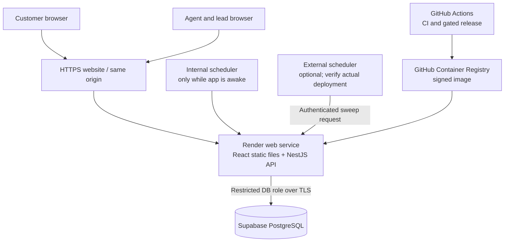
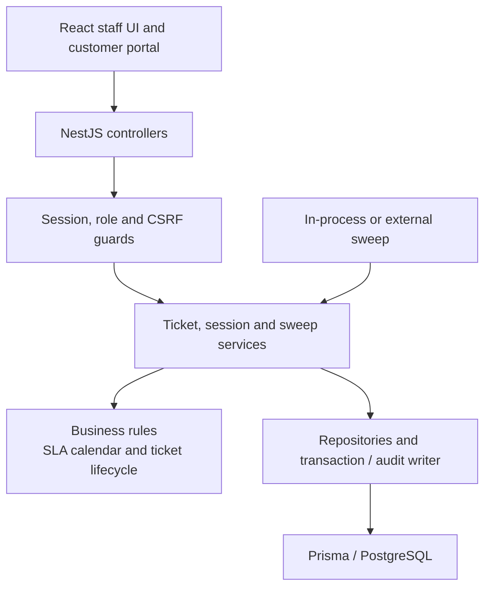
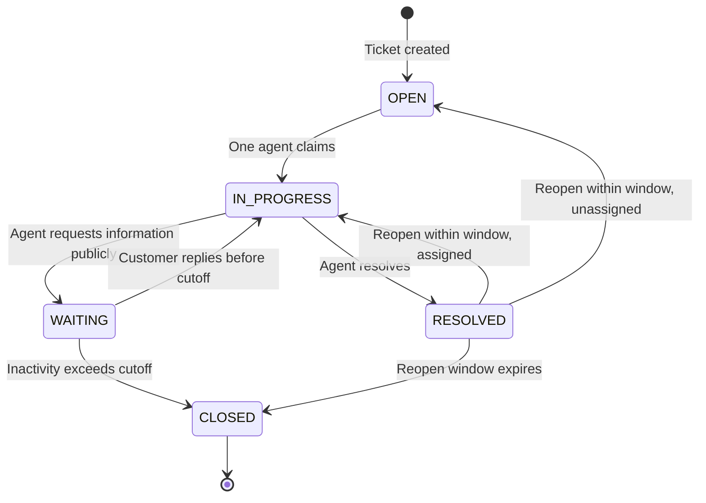
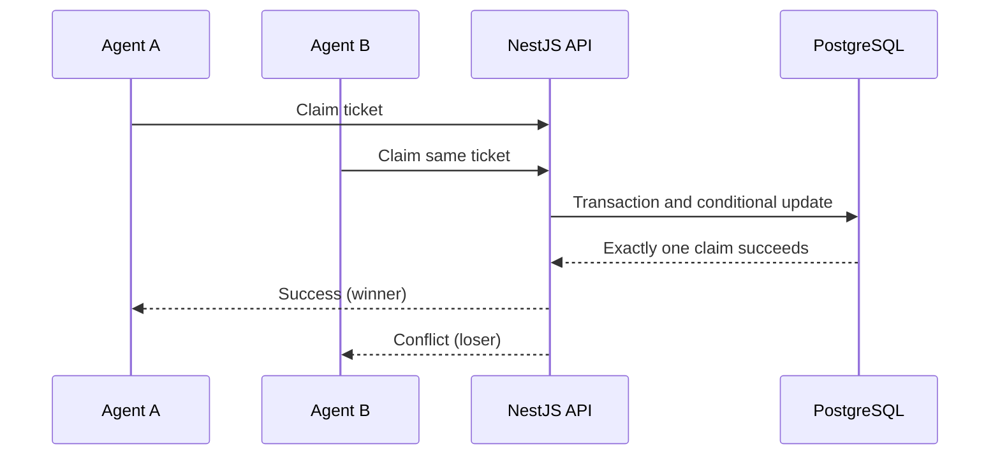
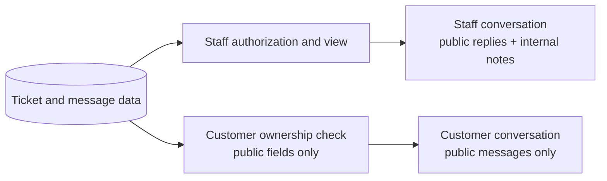
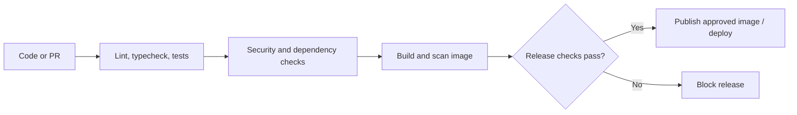
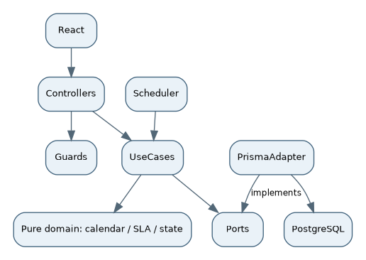
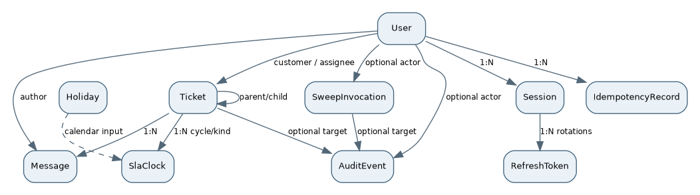
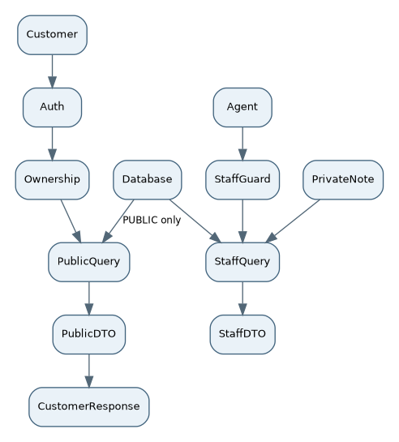

# Frontdesk

**A simple, secure support ticket system for Arvo Systems.**

Frontdesk gives customers one place to ask for help and gives support agents a shared workspace to resolve requests. It tracks who owns each ticket, when a reply or resolution is due, what was said, and what changed.

[**Live demo**](https://frontdesk-arvo-support.onrender.com) · [**Reviewer walkthrough**](docs/REVIEWER_WALKTHROUGH.md) · [**API contract**](docs/openapi.draft.yaml) · [**Deployment guide**](infrastructure/deploy/DEPLOYMENT.md)

## 👋 Reviewer: start here (≈10 minutes)

**1. Open the live demo:** https://frontdesk-arvo-support.onrender.com. Logins were sent through the submission channel. It runs on a free tier, so the first load may take about 40 seconds while it wakes up.

**2. Try three things:**

| Try this | Sign in as | What you should see |
| --- | --- | --- |
| **Claim race:** open **FD-004** in two browser profiles and press _Claim ticket_ in both (a claim can only be won once; **FD-005** is a spare) | Two agents | Only one claim succeeds; the other agent is told who got it |
| **SLA clocks:** _Breached_ → **FD-001**, then _Waiting on customer_ → **FD-006** | Agent | Two separate clocks (response and resolution); the resolution clock is paused while the ticket waits on the customer |
| **Private notes:** open **FD-010**, then view the same ticket in the customer portal | Agent, then customer | The team-only note never reaches the customer, not on screen, not in the API response, not in the JSON/CSV export |

More scenarios: [Reviewer walkthrough](docs/REVIEWER_WALKTHROUGH.md).

**3. If you read only three files:**

- [`apps/api/src/domain/sla/sla-clock.ts`](apps/api/src/domain/sla/sla-clock.ts): the SLA rules as pure functions, with no database or framework code
- [`apps/api/src/tickets/ticket-command.service.ts`](apps/api/src/tickets/ticket-command.service.ts): how every change runs (idempotency reservation → lock the ticket → fresh database time → lock its clocks → apply the domain rule → write the audit → store the outcome), all in one transaction
- [`docs/DOMAIN_CONTRACT.md`](docs/DOMAIN_CONTRACT.md): where the brief was ambiguous, the interpretation I chose, and the exact edge cases

**A note on scope:** I went well past the suggested 8 hours. That was a deliberate choice, and I explain it in [SHORT_NOTE.md](SHORT_NOTE.md). The core of the submission is `apps/`, `packages/contracts/`, `prisma/` and the calendar kernel `src/calendar.mjs`. Most of `infrastructure/` and `docs/` is extra.


## Contents

- [Reviewer: start here](#-reviewer-start-here-10-minutes)
- [What Frontdesk does](#what-frontdesk-does)
- [Features](#features)
- [How to use the app](#how-to-use-the-app-beginners-guide)
- [Demo login accounts and passwords](#demo-login-accounts-and-passwords)
- [Architecture diagrams](#architecture-diagrams)
- [Technology](#technology)
- [Run locally](#run-locally)
- [Configuration](#configuration)
- [Run with Docker](#run-with-docker)
- [Deploy](#deploy)
- [Tests](#tests)
- [Repository structure](#repository-structure)
- [About the git history](#about-the-git-history)
- [Troubleshooting](#troubleshooting)
- [Security and limitations](#security-and-limitations)
- [Further reading](#further-reading)

## What Frontdesk does

A **ticket** is one customer's request for support. Frontdesk keeps the ticket, public conversation, agent assignment, priority, deadlines, and change history together.

1. A customer (or an agent acting for a customer) creates a ticket.
2. It appears in the **Unassigned** queue.
3. One agent claims it. If multiple agents try at once, **only one claim succeeds**.
4. The assigned agent can reply, write private notes, or ask the customer for information.
5. Frontdesk calculates separate **first-response** and **resolution** deadlines using business hours.
6. After resolution, the customer can reopen the ticket during a seven-calendar-day window.
7. Background processing can close eligible inactive or expired tickets; later contact creates a new **linked follow-up** when appropriate.

### User roles

| Role | What it can do |
| --- | --- |
| **Customer** | Create requests, read/reply to own tickets, reopen eligible tickets, export public conversations as JSON or CSV. |
| **Agent** | View support queues, claim tickets, reply to assigned tickets, leave internal notes, change priority and resolve. |
| **Lead** | Work as staff and run an authorized manual SLA sweep. |
| **Admin** | Run authorized administrative sweeps; the role does not silently override ticket ownership. |
| **SYSTEM** | Perform scheduled reconciliation and eligible automatic lifecycle changes. |

## Features

| Area | What is included |
| --- | --- |
| **Ticket workflow** | Create, claim, prioritize, reply, wait for customer, resolve, reopen and linked follow-ups. |
| **Staff workspace** | All, Mine, Unassigned, Breached, Waiting, Resolved and Closed views; priority filter and paginated results. |
| **Customer portal** | Private ticket list, create ticket, conversation detail, replies and JSON/CSV export. |
| **Business-time SLAs** | Two independent clocks for initial public response and resolution; weekends/holidays excluded. |
| **SLA history** | Overdue status, deadline changes, breach history and audit-backed explanations. |
| **Messages** | Public replies versus internal staff-only notes, with older-message loading. |
| **Safe concurrency** | Database transactions and row locks prevent double claims and conflicting lifecycle updates. |
| **Audit trail** | Append-only database-enforced event history; changes and audit records commit together. |
| **Automation** | In-process sweeps while running; manual sweep for authorized staff; optional machine-token endpoint for external scheduling. |
| **Authentication** | Password hashing, refreshable sessions, HttpOnly cookies, CSRF/Origin protection, role and ownership checks. |
| **Operations** | Health/readiness checks, structured logs, optional private metrics and monitoring. |
| **Quality** | Unit, integration, browser and security tests; CI and signed-image release tooling. |

### SLA policy 

Working hours are **Monday–Friday, 09:30–18:30 Asia/Kolkata (IST)**, excluding explicitly configured holidays. Time is stored in UTC.

| Priority | First public response | Resolution |
| --- | --- | --- |
| **Urgent** | 120 working minutes | End of the effective working day |
| **Medium** | 270 working minutes | 1,620 working minutes |
| **Low** | 540 working minutes | 2,700 working minutes |

**Example:** An urgent ticket opened on Friday at 18:00 has a resolution deadline of **Friday 18:30**. Its first-response deadline can be on Monday. These are separate clocks; one does not override the other.

Only a public staff reply counts as the first response. An internal note does not. A public request for information can pause the resolution clock until the customer replies. Waiting-ticket auto-close applies strictly after **2,700 working minutes** of inactivity. Resolved tickets can be reopened for **seven calendar days inclusive**. Changing priority recalculates deadlines based on time **already used**, not from zero. Exact rules and edge cases: [Domain contract](docs/DOMAIN_CONTRACT.md).

## How to use the app (beginner's guide)

**You do not need to understand the code to use Frontdesk.** This section explains what to click in the website, whether you are a customer or a support agent. It describes the frontend currently implemented in `apps/web`.

### First visit: open the website and sign in

1. Open the [hosted Frontdesk demo](https://frontdesk-arvo-support.onrender.com), or `http://localhost:5173` if you followed [Run locally](#run-locally).
2. On the **Sign in** page, enter your **Email** and **Password**, then select **Sign in**.
3. The application opens the correct area for your account:
   - **Customer** → **Support portal** (`/portal`).
   - **Agent / Lead / Admin** → **Staff workspace** (`/staff`).
4. Use **Sign out** when you are finished. Customers find it in the top bar. Staff use the sign-out icon next to their name at the bottom of the sidebar (on phones, open the menu first).

**Where do I get an account?** This demo does **not** have a public self-registration form. A project owner/reviewer provides the hosted credentials privately. For a local demo, run `npm run demo:db` and read `.local/credentials.frontdesk_demo.json` on **your own computer**. Never post passwords in an issue, screenshot, README or commit.

**If the website takes a while to open:** A free Render instance may have gone to sleep and may need time to restart. Wait for the actual page response before retrying. If your session has expired, sign in again.

### A. Customer guide — ask for help and follow a ticket

**1. See your tickets**

After signing in as a customer, you arrive at **Your tickets**. This is a list of your requests, showing their subject and status. Select a ticket to read its public conversation. If there are more items, select **Load more tickets**.

**2. Create a request**

1. Select **New ticket** (top of the customer portal).
2. Fill in **Subject** — a short name such as "Cannot access my account".
3. Fill in **What do you need help with?** — explain the problem, including useful details.
4. Under **How urgent is this for you?**, optionally choose **Urgent**, **Medium**, **Low** or leave **No preference**. This is your *requested* priority; support staff confirm the actual priority.
5. Select **Create ticket**. The new ticket opens automatically.

**3. Read and reply**

Open a ticket from **Your tickets** to see its messages. Type in the **Reply** box and select **Send reply**. If the conversation is long, choose **Load older messages**. You can see public staff replies and information requests, but **not** internal staff notes.

**4. Respond when staff ask for information**

When an agent sends **Request information**, the ticket shows **Waiting for your reply**. Reply with the missing details. If the ticket is still in its waiting window, your reply returns it to **In progress** and the resolution clock resumes. The app does not send an email notification as part of this feature; check the portal itself.

**5. Reopen or create a follow-up**

- If your ticket says **Resolved** and the seven-calendar-day reopen window is still open, enter why you still need help and select **Reopen ticket**. The same ticket resumes.
- If the reopen window expired, or the ticket is **Closed**, type a message and select **Create follow-up ticket** (or the equivalent reopen action on an expired resolved ticket). The system creates a **new linked ticket** so the older history remains intact.

**6. Download a conversation**

Inside a ticket, next to **Download conversation**, select **JSON** or **CSV**. The export contains customer-visible conversation information, not internal staff notes.

### B. Agent guide — work on tickets

The **Staff workspace** has a navigation panel on the left, a ticket list, and a ticket detail/conversation view. On smaller screens, open the **menu** to change views and use **Back to list** to return from a ticket.

**1. Learn the sidebar**

| Sidebar option | What you will find |
| --- | --- |
| **All tickets** | All tickets available to the support team, newest first. |
| **My tickets** | Tickets assigned to you. |
| **Unassigned** | New tickets nobody has claimed yet. |
| **Breached** | Tickets with an overdue response or resolution clock. |
| **Waiting on customer** | Tickets paused while awaiting a customer reply. |
| **Resolved** | Tickets marked resolved, with a limited customer reopen window. |
| **Closed** | Tickets that have been closed or expired. |

Use the priority filter at the top of the list (it shows **All priorities** by default) to show only Urgent, Medium or Low. Each row shows the priority, ticket reference, creation time (IST), subject, assignee, status and both SLA clocks; a red left edge marks a ticket with an overdue clock. Select a ticket row to open it. The refresh icon reloads the list; **Load more tickets** shows additional records.

**2. Claim a ticket**

1. Select **Unassigned** in the sidebar.
2. Open a ticket and read its subject, original request and SLA information.
3. Select **Claim ticket**.
4. After a successful claim, it belongs to you and appears in **My tickets**. You can now reply and perform authorized actions.

If another agent claims the same ticket first, you will see a conflict message telling you that the ticket was already claimed. **Only the assigned agent can change that ticket or send staff messages**; other staff can view permitted information but cannot take over silently.

**3. Understand the ticket detail screen**

The top area shows the ticket reference, **priority**, **status**, customer request, assigned agent, and creation/update times. The **Response** and **Resolution** SLA cards appear below the header, or in a **Service levels** panel on the right on wide screens (1440 px and up). They show the remaining working time, a bar for how much of the working-time budget is used, the deadline, and whether each clock is on track, paused, completed or breached. All of these values come from the server.

Use **Conversation** to read messages, or **SLA history & audit** to see recorded actions, time changes and breaches. The **Load older messages** button retrieves earlier conversation items. Timestamps display in IST.

**4. Send a public reply, private note, or information request**

At the bottom of a ticket you own, choose the intended message type **before** typing:

| Message mode | Button | Who can see it? | Effect |
| --- | --- | --- | --- |
| **Public reply** | **Send public reply** | Customer and staff | The first qualifying public reply completes the initial response clock. |
| **Internal note** | **Add internal note** | Staff only | No SLA clock is completed or paused. |
| **Request information** | **Send request & wait** | Customer and staff | Requests an answer, puts the ticket into **Waiting** and pauses the resolution clock. |

On phones the three modes are labelled **Reply**, **Note** and **Request**. Internal notes are always amber and marked **Internal note · team only**, both in the composer and in the conversation. The modes keep **separate drafts**, so switching from a private note to a public reply does not send your note as a public message. You can also use **Ctrl + Enter** (Windows/Linux) or **⌘ + Enter** (Mac) to send the currently selected message type.

While a ticket is **Waiting**, the assigned agent can add internal notes, but cannot send another ordinary public reply or information request from that composer until the customer responds.

**5. Change priority**

Open an **In progress** or **Waiting** ticket assigned to you. Choose a new value in the priority menu in the ticket header, then select **Apply priority**. Both SLA calculations use time already consumed. **Changing priority does not restart the clocks**; the audit history records the change.

**6. Resolve a ticket**

For an assigned **In progress** ticket, select **Resolve…**, optionally write a customer-visible resolution message, and select **Resolve ticket**. If no public reply has been sent yet, a **resolution message is required** so the first-response requirement is not bypassed. The ticket moves to **Resolved**; the customer can reopen it within seven calendar days.

**7. Record a ticket for a customer**

Select **New ticket** at the top of the staff sidebar. Choose an existing **Customer**, enter a **Subject**, type the **Customer's request**, choose a **Priority**, then select **Create ticket**. This records the original customer request; it is **not** counted as a support reply. The created ticket opens automatically.

### C. Support lead / admin guide — run a manual sweep

A support lead or admin sees an **Administration → Run SLA sweep** action in the staff sidebar. Open it and select **Run sweep now**. The dialog shows the number of tickets processed, auto-closed, expired, breaches recorded and failures.

A sweep processes **only work that is actually due**. It does not simulate passing time or close arbitrary tickets. If the result says more work remains due, run it again. Normal agents and customers **do not** have this control. The background scheduler aims to do the same work automatically, subject to the hosting limitations described under [Deploy](#deploy).

### Ticket statuses explained

| Status shown | Meaning | What usually happens next |
| --- | --- | --- |
| **Open** | New ticket, not yet claimed. | An agent selects **Claim ticket**. |
| **In progress** | An agent is working on it. | Agent replies, requests information or resolves. |
| **Waiting on customer** | Agent asked for more information. | Customer replies; resolution SLA is paused meanwhile. |
| **Resolved** | Agent finished the issue. | Customer accepts the outcome or reopens within the allowed window. |
| **Closed** | Inactivity/expiry cutoff passed. | Future contact creates a linked follow-up ticket. |

**Priority versus status:** *Urgent / Medium / Low* describes how quickly the team should respond and resolve. *Open / In progress / Waiting / Resolved / Closed* describes where the ticket is in its workflow. They are different things.

### Example: try Frontdesk end to end

Here is a practical walkthrough using **sample data**, not a real customer's personal information:

1. **Customer:** Sign in and create a ticket with subject **"Cannot sign in"**, explaining the issue.
2. **Agent:** Sign in using a **different browser profile**, go to **Unassigned**, open that ticket, and select **Claim ticket**.
3. **Agent:** Choose **Public reply**, write **"I am checking your account issue."**, and select **Send public reply**.
4. **Agent:** Choose **Request information**, ask for more details, and select **Send request & wait**.
5. **Customer:** Open the same ticket in the portal and select **Send reply** with the requested details.
6. **Agent:** Return to **My tickets**. Open the ticket, review the new reply and add an **Internal note** if needed.
7. **Agent:** Select **Resolve…**, enter the solution, and select **Resolve ticket**.
8. **Customer:** Open the resolved ticket. If the problem persists, select **Reopen ticket** within the seven-day window.
9. **Agent:** Open **SLA history & audit** to see the recorded transitions and deadline information.

**Tip for reviewers:** To test the predefined historical proof scenarios, follow the [Reviewer walkthrough](docs/REVIEWER_WALKTHROUGH.md). It explains which sample tickets demonstrate breaches, claim races and privacy behavior without changing the system clock.

### Questions new users often ask

- **Can I sign up myself?** Not through the current UI. Use an account supplied by the operator or a local generated demo account.
- **Why is the Reply button missing or disabled?** Only the assigned agent can write to an active staff ticket. Claim an unassigned ticket or open one already assigned to you.
- **Can customers read internal notes?** No. The customer API and exports only return permitted public data.
- **Why did the response clock finish but resolution is still running?** A public staff reply satisfies the first-response requirement; solving the issue has a different deadline.
- **Why can’t I see an email notification?** Frontdesk records messages in the web portal; email sending is not implemented.
- **Why are displayed times in IST?** The configured business calendar uses Asia/Kolkata. Weekends and configured holidays do not count toward working-time SLAs.
- **Why did a follow-up have a different ticket reference?** Once the old ticket can no longer be reopened, new contact becomes a **linked new ticket** to preserve the original history.
- **Why am I signed in as a different user in another tab?** Tabs in the same browser profile share cookies. Use different browser profiles or private contexts when comparing customer and agent views.

## Demo login accounts and passwords

Frontdesk's example accounts are **fictional** and are defined in [`prisma/seed-data.ts`](prisma/seed-data.ts). You can use these emails after the relevant environment has been seeded. The password for **each account is generated randomly**; there is **no universal default password**.

### Staff accounts

| Name | Role | Login email |
| --- | --- | --- |
| Meera Iyer | Support lead | `meera.iyer@arvo.example` |
| Arjun Nair | Agent | `arjun.nair@arvo.example` |
| Priya Sharma | Agent | `priya.sharma@arvo.example` |
| Rohan Mehta | Agent | `rohan.mehta@arvo.example` |
| Kavya Reddy | Agent | `kavya.reddy@arvo.example` |
| Vikram Singh | Agent | `vikram.singh@arvo.example` |
| Ananya Das | Agent | `ananya.das@arvo.example` |
| Imran Khan | Agent | `imran.khan@arvo.example` |
| Sneha Patil | Agent | `sneha.patil@arvo.example` |

### Customer accounts

| Name | Role | Login email |
| --- | --- | --- |
| Aarav Menon | Customer | `aarav.menon@customer.example` |
| Diya Kapoor | Customer | `diya.kapoor@customer.example` |
| Sana Qureshi | Customer | `sana.qureshi@customer.example` |

No separate **Admin** login is seeded by the default demo data. The seeded **Lead** account can demonstrate the administrative sweep control.

### Where to find the passwords

**Local development demo:** After running `npm run demo:db`, the project writes a JSON file **on your machine**, not in GitHub:

```bash
# Run in the project directory; shows the local demo emails and generated passwords.
cat .local/credentials.frontdesk_demo.json
```

The file looks like an email-to-password mapping (example placeholders below, **not valid passwords**):

```json
{
  "meera.iyer@arvo.example": "<random password generated on your machine>",
  "arjun.nair@arvo.example": "<another random password>",
  "aarav.menon@customer.example": "<another random password>"
}
```

Select an email and use **that email's corresponding password** on the Sign in page. Every account can have a different password.

**Production-like local Docker demo:** After explicitly running the optional seed container described under [Run with Docker](#run-with-docker), check `.local/credentials.prod-compose.json` on the machine where the seed ran.

**Hosted Render demo:** Hosted demo passwords are **different** from local passwords and are **not available in this repository**. The deployment operator should retrieve the securely stored credentials from the host seeding process (typically `.local/credentials.hosted.json` **if** that label was used) and share only approved demo account details with each reviewer through a **private channel**. The email addresses above identify the seed accounts; they are not proof that every one exists or is enabled on the current hosted database.

### Recommended accounts for a first-time demo

- **Meera (Lead):** Open the staff workspace and show the **Run SLA sweep** permission.
- **Arjun and Priya (Agents):** Use two different browser profiles to demonstrate who wins a simultaneous **Claim ticket** action.
- **Imran (Agent) and Aarav (Customer):** Demonstrate that an **Internal note** is visible to staff but never exposed to the customer.
- **Sana (Customer):** Demonstrate customer replies and a linked follow-up after the reopen window.

The related seeded ticket references and demo steps are documented in the [Reviewer walkthrough](docs/REVIEWER_WALKTHROUGH.md).

### Keep credentials safe

- **Never paste working passwords** into `README.md`, screenshots, GitHub issues, commits, pull requests, or application logs—even if the repository is private.
- The `.local/` directory is deliberately git-ignored. Keep permissions restricted and share individual hosted demo credentials privately.
- **Do not rerun a production seed or reset passwords just to retrieve a lost password.** Seeding is intended to preserve existing users, and password reset is an explicit, controlled operation.
- If the credentials file is missing, contact the environment operator. New randomly generated passwords for a **separate new local demo** are created by the normal setup steps; a hosted password reset requires explicit authorization.

## Architecture diagrams

### 1. Live deployment — Render and Supabase



**Explanation:** The browser loads the React interface and sends `/api` requests to the **same website**. The NestJS server uses Prisma to access PostgreSQL. The running API has a restricted database account; migrations use a separate owner account.

**Scheduler warning:** A sleeping Render free instance cannot run its in-process timer. The [Supabase cron configuration](infrastructure/deploy/supabase/04-cron.sql) describes an external trigger option. Do not assume it is active until the deployment evidence confirms it.

### 2. Application layers



This is a **modular monolith**: one deployable API with well-separated modules, rather than many microservices. Business rules do not depend on React or NestJS and can be tested separately.

### 3. Ticket lifecycle



When a customer contacts the team after a ticket is already closed, the system creates a **new linked ticket**; it does not reopen a closed record.

### 4. How two agents claim one ticket



The winner depends on the real database race; the diagram uses Agent A as an example. The claim and audit event are committed in a single transaction.

### 5. Privacy boundary



Internal notes must never be returned in customer API responses, exports, or browser network data.

### 6. Release pipeline



Workflows and gates are defined in [`.github/workflows`](.github/workflows/). Check actual GitHub Actions runs for verification, not the diagram alone.

### 7. Original architecture diagram gallery

These **seven images** and their editable `.dot` Graphviz source files are kept in [`docs/diagrams`](docs/diagrams/). They cover the historical system design as well as layers, database relations, ticket states, CI/CD, concurrency, and privacy.

<details>
<summary><strong>High-level system design (historical Vercel proposal)</strong></summary>


This is an **older proposed topology** showing Vercel. The Render/Supabase diagram above describes the currently reported deployment.

</details>

<details>
<summary><strong>Layered application design</strong></summary>



</details>

<details>
<summary><strong>Database relationships (ERD)</strong></summary>



See [Prisma schema](prisma/schema.prisma) for the current authoritative database model.

</details>

<details>
<summary><strong>Ticket state transitions</strong></summary>


</details>

<details>
<summary><strong>Concurrent claim process</strong></summary>


</details>

<details>
<summary><strong>Private versus public data</strong></summary>



</details>

<details>
<summary><strong>CI/CD pipeline</strong></summary>


</details>

More sequence and class diagrams: [`docs/diagrams/sequences.md`](docs/diagrams/sequences.md).

## Technology

- **Frontend:** React 19, Vite, TypeScript, Tailwind CSS, TanStack Query.
- **Backend:** NestJS 11, TypeScript, REST API.
- **Database:** PostgreSQL 16, Prisma 6, migrations and database permissions.
- **Authentication/security:** Argon2id, JWT session cookies, CSRF/Origin checks and role checks.
- **Tests:** Jest, Vitest, Playwright and real PostgreSQL integration tests.
- **DevOps:** Docker/Compose, GitHub Actions, scanning, Render, Supabase, optional Prometheus/Grafana.

## Run locally

### What you need

Node.js **22.12+**, npm, Git, **Docker Desktop** (or Docker + Compose), and a modern browser. The repository is public: `git clone https://github.com/arjunajaygit/frontdesk.git`. No GitHub account is needed to clone it. You do **not** need paid hosting or Supabase to run it locally.

### Step 1 — Get the code

```bash
git clone https://github.com/arjunajaygit/frontdesk.git
cd frontdesk
npm ci
```

### Step 2 — Generate a safe local environment

```bash
npm run env:gen
```

Creates `.env` with random local passwords and independent signing secrets. It does **not** overwrite an existing file. Never commit `.env`.

### Step 3 — Start and migrate PostgreSQL

```bash
npm run db:up
npm run db:migrate
```

Local PostgreSQL is available only on `127.0.0.1:55432`. The application uses a **restricted** role; migration tooling uses the **owner** role.

### Step 4 — Prepare demo users and tickets

```bash
npm run demo:db
```

Creates a separate `frontdesk_demo` database with sample scenarios. Local login credentials are generated at `.local/credentials.frontdesk_demo.json` (git-ignored). The original development database remains separate.

### Step 5 — Start the API in terminal A

```bash
npm run build -w @frontdesk/contracts
npm run build -w @frontdesk/api

set -a
. ./.env
set +a

# Point the restricted app URL at the demo database:
export DATABASE_URL="$(node -e 'const u=new URL(process.env.DATABASE_URL);u.pathname="/frontdesk_demo";console.log(u.toString())')"
PUBLIC_ORIGIN=http://localhost:5173 node apps/api/dist/main.js
```

The API runs on **http://localhost:3000**. Test [liveness](http://localhost:3000/api/healthz) and [database readiness](http://localhost:3000/api/readyz).

### Step 6 — Start the UI in terminal B

```bash
npm run dev -w @frontdesk/web
```

Open **http://localhost:5173** and sign in with a demo user from the local credentials file. Vite forwards `/api` calls to the backend on port 3000. To test two agents simultaneously, use **separate browser profiles**, because ordinary tabs share login cookies.

Stop both processes using Ctrl+C. Run `npm run db:down` to stop the local database container without deleting its volume.

## Configuration

The safe template is [`.env.example`](.env.example). The **authoritative schema**, supported options, validation and defaults are in [`apps/api/src/config/env.ts`](apps/api/src/config/env.ts). Local and hosted credentials must be different.

| Setting | Purpose | Local / default |
| --- | --- | --- |
| `DATABASE_URL` | Restricted app PostgreSQL URL | Generated for `frontdesk_app` |
| `MIGRATION_DATABASE_URL` | Owner connection for migrations/seed | Generated for `frontdesk_owner` |
| `DATABASE_RUNTIME_ROLE` | Expected restricted database role | `frontdesk_app` |
| `NODE_ENV` | Development, test or production mode | `development` |
| `PORT` | API port | `3000` |
| `PUBLIC_ORIGIN` | Exact browser origin, without trailing slash | `http://localhost:5173` |
| `JWT_SECRET` | Authentication signing secret | Independently generated |
| `CSRF_SIGNING_KEY` | CSRF signing secret | Independently generated |
| `BUSINESS_TIMEZONE` | Business calendar timezone | `Asia/Kolkata` |
| `LOG_LEVEL` | Log verbosity | `info` |
| `TRUST_PROXY_HOPS` | Number of trusted reverse-proxy hops | `0` |
| `SWEEP_SCHEDULER_ENABLED` | Enable periodic work while server is awake | `true` |
| `SWEEP_INTERVAL_MS` | Frequency of in-process sweep | `60000` |
| `SWEEP_BATCH_SIZE` | Max items in a sweep batch | `50` |
| `SWEEP_MAX_BATCHES` | Max batches per sweep | `10` |
| `SWEEP_TRIGGER_TOKEN` | Optional token for external machine-triggered sweep | Not set = endpoint disabled |
| `LOGIN_RATE_LIMIT_PER_MIN` | Login rate limit | `10` |
| `API_RATE_LIMIT_PER_MIN` | Per-user API rate limit | `600` |
| `METRICS_PORT` | Separate internal monitoring listener | `0` = off |
| `METRICS_TOKEN` | Scrape credential when metrics are enabled in production | Not set |

The schema also supports database lock timeouts, additional anonymous/IP rate limits, sweep leases/draining, and a private metrics host.

**Rules you should not skip:**

1. Production `PUBLIC_ORIGIN` must use **HTTPS**, exactly matching the browser's origin.
2. `JWT_SECRET` and `CSRF_SIGNING_KEY` must be **different** securely random values (at least 32 decoded bytes each).
3. Never put owner database credentials in the running API. It checks its database privileges at startup.
4. Trust **only** real reverse proxies using `TRUST_PROXY_HOPS`; do not blindly copy a setting from another host.
5. `SWEEP_TRIGGER_TOKEN` is for a machine scheduler, not a user password, and must be separately generated (32–256 characters).
6. The business calendar uses explicitly configured holidays. Do not assume public holidays are automatically loaded.
7. Keep `.env`, `.env.production.local`, tokens and the `.local/` directory out of Git.

## Run with Docker

This production-like setup serves the React website and API from **one origin**, with a local PostgreSQL instance:

```bash
node scripts/gen-env-prod.mjs
npm run prod:up
```

Visit **http://localhost:8080**. Database migrations run in a separate container with owner privileges. Accounts are **not** automatically seeded.

To add local demo accounts explicitly:

```bash
docker compose -p frontdesk-prod --env-file .env.production.local \
  -f infrastructure/docker/compose.prod.yaml --profile ops run --rm seed
```

Then run the authenticated smoke checks:

```bash
node scripts/smoke-prod.mjs --base http://localhost:8080 \
  --creds .local/credentials.prod-compose.json
```

To stop: `npm run prod:down`. The app image uses a multi-stage Docker build, a non-root runtime and a restricted database role.

## Deploy

The documented zero-cost topology uses **Render Free** for the same-origin application and **Supabase** for PostgreSQL. The release pipeline can publish a scanned/signed container image to GitHub Container Registry.

**Deployment flow:**

1. Prepare the isolated Supabase database; configure separate schema-owner and runtime roles.
2. Run [`01-provision.sql`](infrastructure/deploy/supabase/01-provision.sql), versioned Prisma migrations, [`02-post-migrate.sql`](infrastructure/deploy/supabase/02-post-migrate.sql) and [`03-verify.sql`](infrastructure/deploy/supabase/03-verify.sql) using the documented roles.
3. Run the CI/security checks, build the reviewed image, and deploy it to Render.
4. Configure `NODE_ENV=production`, exact HTTPS `PUBLIC_ORIGIN`, restricted `DATABASE_URL`, correct `TRUST_PROXY_HOPS` and independent secrets **in the provider environment**, never source control.
5. Check `/api/healthz` and `/api/readyz`, then perform authenticated smoke, CSRF, cookie and privacy checks.
6. If the web service sleeps, configure and **verify** an external scheduler. The [Supabase cron proposal](infrastructure/deploy/supabase/04-cron.sql) requires pg_cron, pg_net and Vault support. Record a real invocation before marking the scheduler operational.

Read the full [deployment procedure](infrastructure/deploy/DEPLOYMENT.md) before deploying. It documents prerequisite checks, privilege separation, tested procedures and provider limitations. Free hosting may sleep after inactivity, delay cron processing, or restart at any time; it does not provide guaranteed uptime.

## Tests

| Command | What it does |
| --- | --- |
| `npm run test:calendar` | Calendar rules and working-time boundaries |
| `npm run test:unit` | Pure domain and backend unit tests |
| `npm run test:web` | Frontend unit/component tests |
| `npm run test:integration` | Real PostgreSQL integration and concurrency proofs |
| `npm run test:e2e` | Playwright browser workflows, privacy and accessibility checks |
| `npm test` | Calendar + release gate + unit + integration |
| `npm run typecheck` | TypeScript checks |
| `npm run lint` | ESLint |
| `npm run format:check` | Prettier |
| `npm run verify:openapi` | API contract consistency |
| `npm run verify:secrets` | Secret scanning |
| `npm run test:release-gate` | Release policy tests |

The integration suite needs a running/test PostgreSQL environment; follow [testing strategy](docs/TESTING_STRATEGY.md). On first use, Playwright may require `npx playwright install`. Never run destructive test/seed commands against a production database.

**Verify a live deployment** (no secrets are printed; reviewer accounts are only signed in, never modified):

| Script | What it checks |
| --- | --- |
| `node scripts/smoke-prod.mjs --base <url> --creds <file>` | Cookies, HSTS, CSRF/Origin, privacy in detail and CSV, logout replay |
| `OWNER_URL=… node scripts/hosted-verify.mjs --base <url> --creds <file>` | Workflows on synthetic tickets, checked against the database |
| `OWNER_URL=… node scripts/hosted-browser.mjs --base <url> --creds <file>` | Real-browser privacy, two tabs, session restore, cross-tab sign-out |
| `node scripts/hosted-runtime-health.mjs --base <url> --creds <file>` | Every screen at three widths: no console errors, failed assets or overflow |

Results of the final audit: [functional test report](docs/FINAL_FUNCTIONAL_TEST_REPORT.md) and [assessment compliance matrix](docs/FINAL_ASSESSMENT_COMPLIANCE.md).

## Repository structure

```text
frontdesk/
├── apps/
│   ├── api/                  NestJS backend and domain services
│   └── web/                  React frontend
├── packages/contracts/       Shared validation and audit schemas
├── prisma/                   Database schema, migrations, seed
├── src/                      Business-calendar kernel
├── tests/                    Unit, integration, E2E, release checks
├── docs/
│   └── diagrams/             Architecture diagrams and editable sources
├── infrastructure/
│   ├── deploy/               Hosted setup and SQL
│   ├── docker/               Compose configurations
│   ├── monitoring/           Optional Grafana and Prometheus
│   ├── ops/                  Operations scripts
│   └── security/             Security rules/tools
├── scripts/                  Environment, database and release scripts
├── .github/workflows/        CI, security and release pipelines
├── .env.example              Safe settings template
├── Dockerfile                Runtime and migration builds
└── README.md                 Project guide
```

## About the git history

This public repository is published from my private working repository as **sanitized snapshots**, not as the original commit-by-commit history. [`scripts/build-publication.sh`](scripts/build-publication.sh) exports an exact private revision with `git archive`, deletes the six paths listed in [`infrastructure/publish/EXCLUDE.txt`](infrastructure/publish/EXCLUDE.txt) (the employer's assessment PDF, an internal baseline PDF, a raw private audit report and AI-agent configuration files), and refuses to commit if any withheld path, forbidden file type (PDF, `.env`, keys, credential JSON) or local personal marker survives. Secrets were never committed in the first place (they live in git-ignored files); the check simply fails closed if one ever appears. Each snapshot is appended without rewriting earlier ones, and [`PROVENANCE.md`](PROVENANCE.md) records the exact source revision. Pull-request merges made on GitHub sit between the snapshots.

Milestone-by-milestone progress, decisions and mistakes are in [`docs/IMPLEMENTATION_NOTES.md`](docs/IMPLEMENTATION_NOTES.md). Precise wall-clock times were recorded from M7 onward; the earlier milestones state that they were not.

## Troubleshooting

| Problem | Suggested fix |
| --- | --- |
| Node.js engine error | Install Node **22.12+**, then run `npm ci`. |
| Database connection refused | Start Docker Desktop, then run `npm run db:up`. Check port `55432`. |
| Database permission check fails | Confirm the API is using the restricted role, and that migrations ran as the owner. **Do not disable the safety check.** |
| No demo logins | Run `npm run demo:db` and inspect the locally generated `.local/credentials.frontdesk_demo.json`. |
| Browser API requests fail | Make sure API port `3000` and web port `5173` are both running. |
| CSRF/Origin error | Check that `PUBLIC_ORIGIN` matches the browser origin exactly and proxy/cookie settings are correct. |
| Hosted page loads slowly | The free Render instance may be waking from sleep. Check the service logs. |
| Background closures are late | Verify that an external sweep job actually runs while the web service sleeps. |

## Security and limitations

**Security design:** deny-by-default authorization, per-customer data isolation, internal-note filtering, HttpOnly sessions, CSRF + Origin validation, Argon2id password hashing, restricted database runtime account, append-only audit triggers, bounded transaction locks, idempotency and redacted logging.

**Known limits:** In-process rate limiting is designed for a single instance; full-text search and aggregate ticket counts are not available. Email delivery/read receipts are not implemented. Automated accessibility checks are not a manual screen-reader audit or WCAG certification. Monitoring definitions do not prove that notifications are delivered. Free hosting cannot promise uninterrupted availability or precise sweep times; high availability, full disaster recovery and backup/restore timing must not be assumed demonstrated.


## Further reading

[Assessment compliance](docs/FINAL_ASSESSMENT_COMPLIANCE.md) · [Glossary of internal tags](docs/GLOSSARY.md) · [Functional test report](docs/FINAL_FUNCTIONAL_TEST_REPORT.md) · [Deployment evidence](docs/M8_DEPLOYMENT_EVIDENCE.md) · [Reviewer walkthrough](docs/REVIEWER_WALKTHROUGH.md) · [High-level design](docs/HLD.md) · [Low-level design](docs/LLD.md) · [Database design](docs/DATABASE_DESIGN.md) · [Domain rules](docs/DOMAIN_CONTRACT.md) · [Auth contract](docs/AUTH_CONTRACT.md) · [Sweep contract](docs/SWEEP_CONTRACT.md) · [Security architecture](docs/SECURITY_ARCHITECTURE.md) · [DevSecOps](docs/DEVSECOPS.md) · [Risk register](docs/RISK_REGISTER.md) · [Engineering proofs](docs/ENGINEERING_PROOFS.md)

---

**Frontdesk — clear ownership, accurate business-time deadlines, private conversations, and traceable decisions.**
