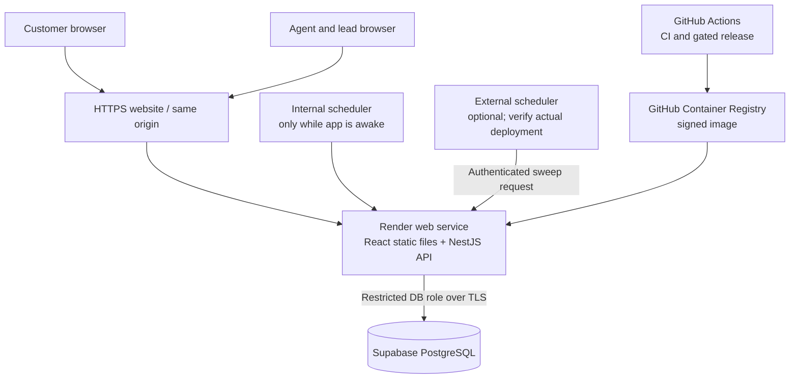
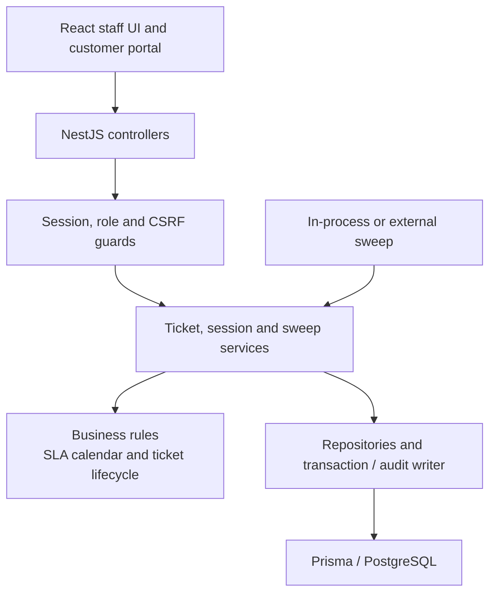
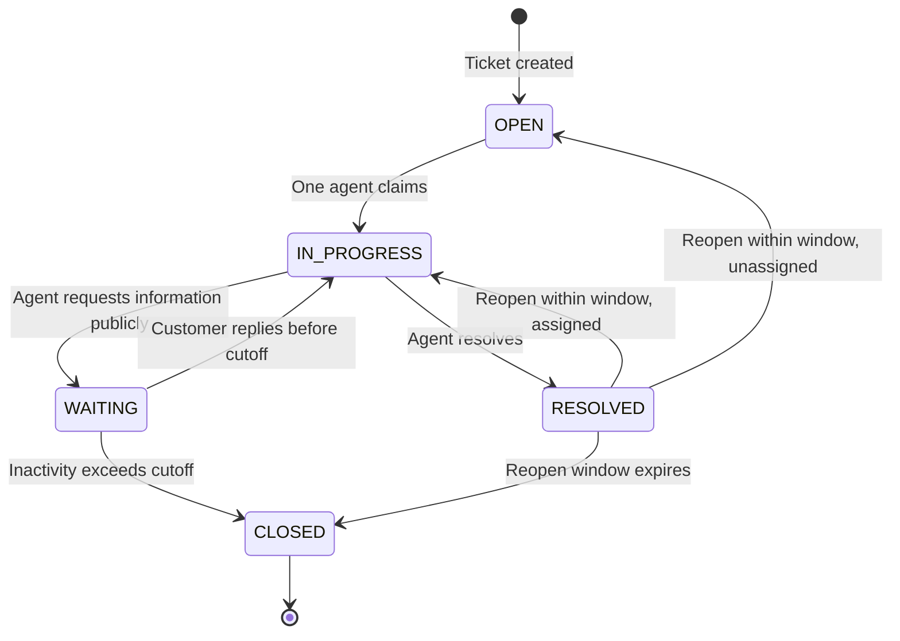
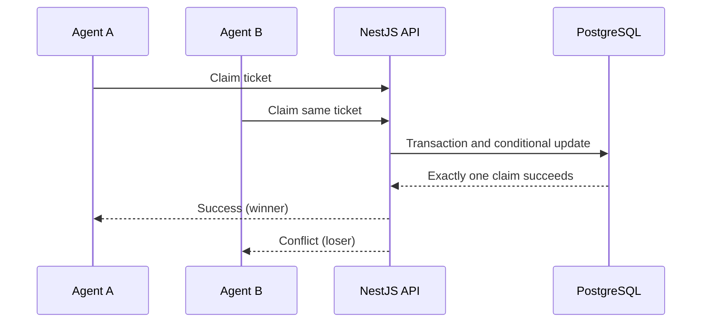
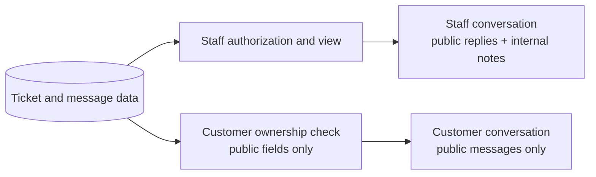
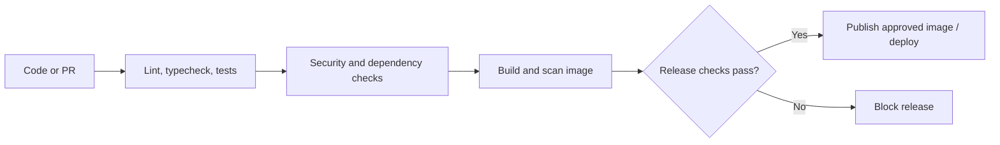
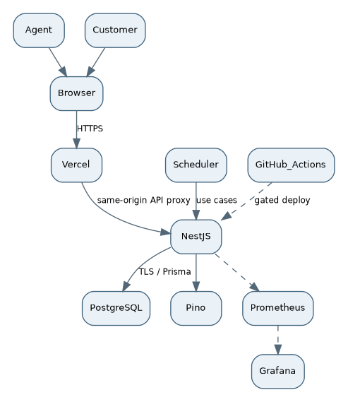
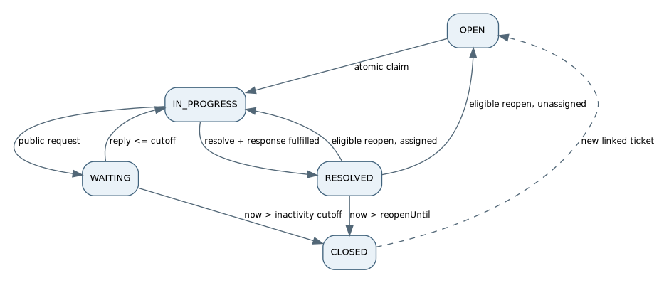
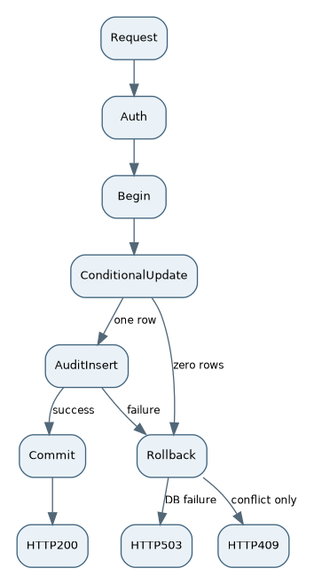
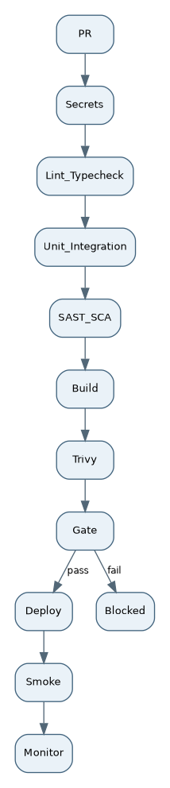

# Frontdesk

**A simple, secure support ticket system for Arvo Systems.**

Frontdesk gives customers one place to ask for help and gives support agents a shared workspace to resolve requests. It tracks who owns each ticket, when a reply or resolution is due, what was said, and what changed.

[**Live demo**](https://frontdesk-arvo-support.onrender.com) · [**Reviewer walkthrough**](docs/REVIEWER_WALKTHROUGH.md) · [**API contract**](docs/openapi.draft.yaml) · [**Deployment guide**](infrastructure/deploy/DEPLOYMENT.md)

> **Deployment status (22 November 2026):** The project owner reports that Frontdesk is deployed on Render with a Supabase database. The free web service can sleep when idle, so the first request may be slow. External scheduling/cold-start evidence is being finalized. Some older engineering notes still describe the original pre-deployment plan; those are kept as historical records. The link above is not an uptime guarantee.

## Contents

- [What Frontdesk does](#what-frontdesk-does)
- [Features](#features)
- [Architecture diagrams](#architecture-diagrams)
- [Technology](#technology)
- [Run locally](#run-locally)
- [Configuration](#configuration)
- [Run with Docker](#run-with-docker)
- [Deploy](#deploy)
- [Tests](#tests)
- [Repository structure](#repository-structure)
- [Troubleshooting](#troubleshooting)
- [Security and limitations](#security-and-limitations)
- [Further reading](#further-reading)

## What Frontdesk does

A **ticket** is one customer's request for support. Frontdesk keeps the ticket, public conversation, agent assignment, priority, deadlines, and change history together.

1. A customer (or an agent acting for a customer) creates a ticket.
2. It appears in the **Unassigned** queue.
3. One agent claims it. If multiple agents try at once, **only one claim succeeds**.
4. The assigned agent can reply, write private notes, or ask the customer for information.
5. Frontdesk calculates separate **first-response** and **resolution** deadlines using business hours.
6. After resolution, the customer can reopen the ticket during a seven-calendar-day window.
7. Background processing can close eligible inactive or expired tickets; later contact creates a new **linked follow-up** when appropriate.

### User roles

| Role | What it can do |
| --- | --- |
| **Customer** | Create requests, read/reply to own tickets, reopen eligible tickets, export public conversations as JSON or CSV. |
| **Agent** | View support queues, claim tickets, reply to assigned tickets, leave internal notes, change priority and resolve. |
| **Lead** | Work as staff and run an authorized manual SLA sweep. |
| **Admin** | Run authorized administrative sweeps; the role does not silently override ticket ownership. |
| **SYSTEM** | Perform scheduled reconciliation and eligible automatic lifecycle changes. |

## Features

| Area | What is included |
| --- | --- |
| **Ticket workflow** | Create, claim, prioritize, reply, wait for customer, resolve, reopen and linked follow-ups. |
| **Staff workspace** | All, Mine, Unassigned, Breached, Waiting, Resolved and Closed views; priority filter and paginated results. |
| **Customer portal** | Private ticket list, create ticket, conversation detail, replies and JSON/CSV export. |
| **Business-time SLAs** | Two independent clocks for initial public response and resolution; weekends/holidays excluded. |
| **SLA history** | Overdue status, deadline changes, breach history and audit-backed explanations. |
| **Messages** | Public replies versus internal staff-only notes, with older-message loading. |
| **Safe concurrency** | Database transactions and row locks prevent double claims and conflicting lifecycle updates. |
| **Audit trail** | Append-only database-enforced event history; changes and audit records commit together. |
| **Automation** | In-process sweeps while running; manual sweep for authorized staff; optional machine-token endpoint for external scheduling. |
| **Authentication** | Password hashing, refreshable sessions, HttpOnly cookies, CSRF/Origin protection, role and ownership checks. |
| **Operations** | Health/readiness checks, structured logs, optional private metrics and monitoring. |
| **Quality** | Unit, integration, browser and security tests; CI and signed-image release tooling. |

### SLA policy in plain English

Working hours are **Monday–Friday, 09:30–18:30 Asia/Kolkata (IST)**, excluding explicitly configured holidays. Time is stored in UTC.

| Priority | First public response | Resolution |
| --- | --- | --- |
| **Urgent** | 120 working minutes | End of the effective working day |
| **Medium** | 270 working minutes | 1,620 working minutes |
| **Low** | 540 working minutes | 2,700 working minutes |

**Example:** An urgent ticket opened on Friday at 18:00 has a resolution deadline of **Friday 18:30**. Its first-response deadline can be on Monday. These are separate clocks; one does not override the other.

Only a public staff reply counts as the first response. An internal note does not. A public request for information can pause the resolution clock until the customer replies. Waiting-ticket auto-close applies strictly after **2,700 working minutes** of inactivity. Resolved tickets can be reopened for **seven calendar days inclusive**. Changing priority recalculates deadlines based on time **already used**, not from zero. Exact rules and edge cases: [Domain contract](docs/DOMAIN_CONTRACT.md).

## Architecture diagrams

### 1. Live deployment — Render and Supabase



**Explanation:** The browser loads the React interface and sends `/api` requests to the **same website**. The NestJS server uses Prisma to access PostgreSQL. The running API has a restricted database account; migrations use a separate owner account.

**Scheduler warning:** A sleeping Render free instance cannot run its in-process timer. The [Supabase cron configuration](infrastructure/deploy/supabase/04-cron.sql) describes an external trigger option. Do not assume it is active until the deployment evidence confirms it.

### 2. Application layers



This is a **modular monolith**: one deployable API with well-separated modules, rather than many microservices. Business rules do not depend on React or NestJS and can be tested separately.

### 3. Ticket lifecycle



When a customer contacts the team after a ticket is already closed, the system creates a **new linked ticket**; it does not reopen a closed record.

### 4. How two agents claim one ticket



The winner depends on the real database race; the diagram uses Agent A as an example. The claim and audit event are committed in a single transaction.

### 5. Privacy boundary



Internal notes must never be returned in customer API responses, exports, or browser network data.

### 6. Release pipeline



Workflows and gates are defined in [`.github/workflows`](.github/workflows/). Check actual GitHub Actions runs for verification, not the diagram alone.

### 7. Original architecture diagram gallery

These **seven images** and their editable `.dot` Graphviz source files are kept in [`docs/diagrams`](docs/diagrams/). They cover the historical system design as well as layers, database relations, ticket states, CI/CD, concurrency, and privacy.

<details>
<summary><strong>High-level system design (historical Vercel proposal)</strong></summary>



This is an **older proposed topology** showing Vercel. The Render/Supabase diagram above describes the currently reported deployment.

</details>

<details>
<summary><strong>Layered application design</strong></summary>


</details>

<details>
<summary><strong>Database relationships (ERD)</strong></summary>


See [Prisma schema](prisma/schema.prisma) for the current authoritative database model.

</details>

<details>
<summary><strong>Ticket state transitions</strong></summary>



</details>

<details>
<summary><strong>Concurrent claim process</strong></summary>



</details>

<details>
<summary><strong>Private versus public data</strong></summary>


</details>

<details>
<summary><strong>CI/CD pipeline</strong></summary>



</details>

More sequence and class diagrams: [`docs/diagrams/sequences.md`](docs/diagrams/sequences.md).

## Technology

- **Frontend:** React 19, Vite, TypeScript, Tailwind CSS, TanStack Query.
- **Backend:** NestJS 11, TypeScript, REST API.
- **Database:** PostgreSQL 16, Prisma 6, migrations and database permissions.
- **Authentication/security:** Argon2id, JWT session cookies, CSRF/Origin checks and role checks.
- **Tests:** Jest, Vitest, Playwright and real PostgreSQL integration tests.
- **DevOps:** Docker/Compose, GitHub Actions, scanning, Render, Supabase, optional Prometheus/Grafana.

## Run locally

### What you need

Node.js **22.12+**, npm, Git, **Docker Desktop** (or Docker + Compose), and a modern browser. The project is a private repository, so cloning it needs GitHub access. You do **not** need paid hosting or Supabase to run it locally.

### Step 1 — Get the code

```bash
git clone https://github.com/arjunajaygit/frontdesk.git
cd frontdesk
npm ci
```

### Step 2 — Generate a safe local environment

```bash
npm run env:gen
```

Creates `.env` with random local passwords and independent signing secrets. It does **not** overwrite an existing file. Never commit `.env`.

### Step 3 — Start and migrate PostgreSQL

```bash
npm run db:up
npm run db:migrate
```

Local PostgreSQL is available only on `127.0.0.1:55432`. The application uses a **restricted** role; migration tooling uses the **owner** role.

### Step 4 — Prepare demo users and tickets

```bash
npm run demo:db
```

Creates a separate `frontdesk_demo` database with sample scenarios. Local login credentials are generated at `.local/credentials.frontdesk_demo.json` (git-ignored). The original development database remains separate.

### Step 5 — Start the API in terminal A

```bash
npm run build -w @frontdesk/contracts
npm run build -w @frontdesk/api

set -a
. ./.env
set +a

# Point the restricted app URL at the demo database:
export DATABASE_URL="$(node -e 'const u=new URL(process.env.DATABASE_URL);u.pathname="/frontdesk_demo";console.log(u.toString())')"
PUBLIC_ORIGIN=http://localhost:5173 node apps/api/dist/main.js
```

The API runs on **http://localhost:3000**. Test [liveness](http://localhost:3000/api/healthz) and [database readiness](http://localhost:3000/api/readyz).

### Step 6 — Start the UI in terminal B

```bash
npm run dev -w @frontdesk/web
```

Open **http://localhost:5173** and sign in with a demo user from the local credentials file. Vite forwards `/api` calls to the backend on port 3000. To test two agents simultaneously, use **separate browser profiles**, because ordinary tabs share login cookies.

Stop both processes using Ctrl+C. Run `npm run db:down` to stop the local database container without deleting its volume.

## Configuration

The safe template is [`.env.example`](.env.example). The **authoritative schema**, supported options, validation and defaults are in [`apps/api/src/config/env.ts`](apps/api/src/config/env.ts). Local and hosted credentials must be different.

| Setting | Purpose | Local / default |
| --- | --- | --- |
| `DATABASE_URL` | Restricted app PostgreSQL URL | Generated for `frontdesk_app` |
| `MIGRATION_DATABASE_URL` | Owner connection for migrations/seed | Generated for `frontdesk_owner` |
| `DATABASE_RUNTIME_ROLE` | Expected restricted database role | `frontdesk_app` |
| `NODE_ENV` | Development, test or production mode | `development` |
| `PORT` | API port | `3000` |
| `PUBLIC_ORIGIN` | Exact browser origin, without trailing slash | `http://localhost:5173` |
| `JWT_SECRET` | Authentication signing secret | Independently generated |
| `CSRF_SIGNING_KEY` | CSRF signing secret | Independently generated |
| `BUSINESS_TIMEZONE` | Business calendar timezone | `Asia/Kolkata` |
| `LOG_LEVEL` | Log verbosity | `info` |
| `TRUST_PROXY_HOPS` | Number of trusted reverse-proxy hops | `0` |
| `SWEEP_SCHEDULER_ENABLED` | Enable periodic work while server is awake | `true` |
| `SWEEP_INTERVAL_MS` | Frequency of in-process sweep | `60000` |
| `SWEEP_BATCH_SIZE` | Max items in a sweep batch | `50` |
| `SWEEP_MAX_BATCHES` | Max batches per sweep | `10` |
| `SWEEP_TRIGGER_TOKEN` | Optional token for external machine-triggered sweep | Not set = endpoint disabled |
| `LOGIN_RATE_LIMIT_PER_MIN` | Login rate limit | `10` |
| `API_RATE_LIMIT_PER_MIN` | Per-user API rate limit | `600` |
| `METRICS_PORT` | Separate internal monitoring listener | `0` = off |
| `METRICS_TOKEN` | Scrape credential when metrics are enabled in production | Not set |

The schema also supports database lock timeouts, additional anonymous/IP rate limits, sweep leases/draining, and a private metrics host.

**Rules you should not skip:**

1. Production `PUBLIC_ORIGIN` must use **HTTPS**, exactly matching the browser's origin.
2. `JWT_SECRET` and `CSRF_SIGNING_KEY` must be **different** securely random values (at least 32 decoded bytes each).
3. Never put owner database credentials in the running API. It checks its database privileges at startup.
4. Trust **only** real reverse proxies using `TRUST_PROXY_HOPS`; do not blindly copy a setting from another host.
5. `SWEEP_TRIGGER_TOKEN` is for a machine scheduler, not a user password, and must be separately generated (32–256 characters).
6. The business calendar uses explicitly configured holidays. Do not assume public holidays are automatically loaded.
7. Keep `.env`, `.env.production.local`, tokens and the `.local/` directory out of Git.

## Run with Docker

This production-like setup serves the React website and API from **one origin**, with a local PostgreSQL instance:

```bash
node scripts/gen-env-prod.mjs
npm run prod:up
```

Visit **http://localhost:8080**. Database migrations run in a separate container with owner privileges. Accounts are **not** automatically seeded.

To add local demo accounts explicitly:

```bash
docker compose -p frontdesk-prod --env-file .env.production.local \
  -f infrastructure/docker/compose.prod.yaml --profile ops run --rm seed
```

Then run the authenticated smoke checks:

```bash
node scripts/smoke-prod.mjs --base http://localhost:8080 \
  --creds .local/credentials.prod-compose.json
```

To stop: `npm run prod:down`. The app image uses a multi-stage Docker build, a non-root runtime and a restricted database role.

## Deploy

The documented zero-cost topology uses **Render Free** for the same-origin application and **Supabase** for PostgreSQL. The release pipeline can publish a scanned/signed container image to GitHub Container Registry.

**Deployment flow:**

1. Prepare the isolated Supabase database; configure separate schema-owner and runtime roles.
2. Run [`01-provision.sql`](infrastructure/deploy/supabase/01-provision.sql), versioned Prisma migrations, [`02-post-migrate.sql`](infrastructure/deploy/supabase/02-post-migrate.sql) and [`03-verify.sql`](infrastructure/deploy/supabase/03-verify.sql) using the documented roles.
3. Run the CI/security checks, build the reviewed image, and deploy it to Render.
4. Configure `NODE_ENV=production`, exact HTTPS `PUBLIC_ORIGIN`, restricted `DATABASE_URL`, correct `TRUST_PROXY_HOPS` and independent secrets **in the provider environment**, never source control.
5. Check `/api/healthz` and `/api/readyz`, then perform authenticated smoke, CSRF, cookie and privacy checks.
6. If the web service sleeps, configure and **verify** an external scheduler. The [Supabase cron proposal](infrastructure/deploy/supabase/04-cron.sql) requires pg_cron, pg_net and Vault support. Record a real invocation before marking the scheduler operational.

Read the full [deployment procedure](infrastructure/deploy/DEPLOYMENT.md) before deploying. It documents prerequisite checks, privilege separation, tested procedures and provider limitations. Free hosting may sleep after inactivity, delay cron processing, or restart at any time; it does not provide guaranteed uptime.

## Tests

| Command | What it does |
| --- | --- |
| `npm run test:calendar` | Calendar rules and working-time boundaries |
| `npm run test:unit` | Pure domain and backend unit tests |
| `npm run test:web` | Frontend unit/component tests |
| `npm run test:integration` | Real PostgreSQL integration and concurrency proofs |
| `npm run test:e2e` | Playwright browser workflows, privacy and accessibility checks |
| `npm test` | Calendar + release gate + unit + integration |
| `npm run typecheck` | TypeScript checks |
| `npm run lint` | ESLint |
| `npm run format:check` | Prettier |
| `npm run verify:openapi` | API contract consistency |
| `npm run verify:secrets` | Secret scanning |
| `npm run test:release-gate` | Release policy tests |

The integration suite needs a running/test PostgreSQL environment; follow [testing strategy](docs/TESTING_STRATEGY.md). On first use, Playwright may require `npx playwright install`. Never run destructive test/seed commands against a production database.

## Repository structure

```text
frontdesk/
├── apps/
│   ├── api/                  NestJS backend and domain services
│   └── web/                  React frontend
├── packages/contracts/       Shared validation and audit schemas
├── prisma/                   Database schema, migrations, seed
├── src/                      Business-calendar kernel
├── tests/                    Unit, integration, E2E, release checks
├── docs/
│   └── diagrams/             Architecture diagrams and editable sources
├── infrastructure/
│   ├── deploy/               Hosted setup and SQL
│   ├── docker/               Compose configurations
│   ├── monitoring/           Optional Grafana and Prometheus
│   ├── ops/                  Operations scripts
│   └── security/             Security rules/tools
├── scripts/                  Environment, database and release scripts
├── .github/workflows/        CI, security and release pipelines
├── .env.example              Safe settings template
├── Dockerfile                Runtime and migration builds
└── README.md                 Project guide
```

## Troubleshooting

| Problem | Suggested fix |
| --- | --- |
| Node.js engine error | Install Node **22.12+**, then run `npm ci`. |
| Database connection refused | Start Docker Desktop, then run `npm run db:up`. Check port `55432`. |
| Database permission check fails | Confirm the API is using the restricted role, and that migrations ran as the owner. **Do not disable the safety check.** |
| No demo logins | Run `npm run demo:db` and inspect the locally generated `.local/credentials.frontdesk_demo.json`. |
| Browser API requests fail | Make sure API port `3000` and web port `5173` are both running. |
| CSRF/Origin error | Check that `PUBLIC_ORIGIN` matches the browser origin exactly and proxy/cookie settings are correct. |
| Hosted page loads slowly | The free Render instance may be waking from sleep. Check the service logs. |
| Background closures are late | Verify that an external sweep job actually runs while the web service sleeps. |

## Security and limitations

**Security design:** deny-by-default authorization, per-customer data isolation, internal-note filtering, HttpOnly sessions, CSRF + Origin validation, Argon2id password hashing, restricted database runtime account, append-only audit triggers, bounded transaction locks, idempotency and redacted logging.

**Known limits:** In-process rate limiting is designed for a single instance; full-text search and aggregate ticket counts are not available. Email delivery/read receipts are not implemented. Automated accessibility checks are not a manual screen-reader audit or WCAG certification. Monitoring definitions do not prove that notifications are delivered. Free hosting cannot promise uninterrupted availability or precise sweep times; high availability, full disaster recovery and backup/restore timing must not be assumed demonstrated.

This repository is a **sanitized publication snapshot**. Private assessment documents, agent instructions and sensitive local credentials are intentionally excluded. See [PROVENANCE.md](PROVENANCE.md). Preserve real test and release evidence rather than deleting it simply to make the repository appear smaller.

## Further reading

[Reviewer walkthrough](docs/REVIEWER_WALKTHROUGH.md) · [High-level design](docs/HLD.md) · [Low-level design](docs/LLD.md) · [Database design](docs/DATABASE_DESIGN.md) · [Domain rules](docs/DOMAIN_CONTRACT.md) · [Auth contract](docs/AUTH_CONTRACT.md) · [Sweep contract](docs/SWEEP_CONTRACT.md) · [Security architecture](docs/SECURITY_ARCHITECTURE.md) · [DevSecOps](docs/DEVSECOPS.md) · [Risk register](docs/RISK_REGISTER.md) · [Engineering proofs](docs/ENGINEERING_PROOFS.md)

---

**Frontdesk — clear ownership, accurate business-time deadlines, private conversations, and traceable decisions.**
