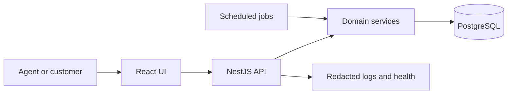

# Frontdesk | Engineering specification
Baseline: the original assessment brief, sections 2–6. This is a proposed implementation baseline, not completed software.

## Scope and acceptance
Arvo Systems has nine agents and approximately 40 problems daily. Replace spreadsheet and WhatsApp workflows with a hosted support backend and simple agent screen. No banking, AI, payments or native mobile features.

| ID | Requirement | Acceptance evidence |
|---|---|---|
| R01 | Priority-specific first response and resolution SLA | deterministic clock tests |
| R02 | 09:30–18:30 Monday–Friday, excluding festival holidays | Friday, weekend and holiday tests |
| R03 | Pause SLA while awaiting customer | pause/resume test |
| R04 | Close after about one working week without reply | restart-safe closure test |
| R05 | Reopen resolved ticket within about one week | boundary and late-new-ticket tests |
| R06 | Agent screen: own tickets, late/waiting indicators, replies and notes | browser acceptance |
| R07 | Only one agent can claim a ticket (INC-0291) | nine concurrent claims, one winner |
| R08 | Never disclose private team notes (INC-0304) | customer detail/list/export negative tests |
| R09 | Record who, what, when; no later edits (INC-0318) | transactional audit and DB permission tests |
| R10 | Hosted URL for one week, repository, setup README and honest omissions note | deployment smoke and submission checklist |

## Decisions and assumptions (not source requirements)
Use Asia/Kolkata by default, configurable timezone; store UTC. Nine business hours per day. Medium response 270 minutes, resolution 1620; low response 540, resolution 2700; urgent response 120. Urgent resolution is end of the effective working day, with paused time excluded; if received outside hours, use next eligible day. Document late-day arrival trade-off. Holiday dates are explicitly configured, never guessed. Follow a half-open business interval [09:30,18:30). Breach when now exceeds deadline. First public agent reply completes response clock; private note does not. Pause only when explicitly requesting customer response; resume on customer reply. Inactivity auto-close after 2700 business minutes; reopening window is seven calendar days from resolution, inclusive at boundary. Later contact creates a new linked ticket. Reopening starts a new resolution cycle, preserves prior history and breach facts. Priority changes apply new budgets to already consumed business minutes; do not reset elapsed time or erase prior breaches. For urgent use effective cycle day's closing time as initial budget. These policy choices must be reviewed and clearly documented.

## HLD
React + TypeScript + Vite → NestJS REST API → PostgreSQL via Prisma. Nest scheduler processes persisted due work. Same database, one deployable backend initially; extract worker only if justified. Vercel frontend, Render backend, managed PostgreSQL. Prefer same-origin reverse proxy for cookies; otherwise exact CORS allowlist, secure cookie/CSRF design. No Redis, Kafka, Kubernetes, microservices or Go. Use strict TS, ESLint, Prettier, TanStack Query, Tailwind/shadcn when installed.

## LLD and invariants
Modules: auth/users, tickets, calendar/SLA, conversations, audit, jobs, health. Controllers validate and authorize; application use cases coordinate transactions; pure domain functions do time and state calculations; Prisma adapters persist. Do not introduce generic repositories merely for ceremony. Inject clock; avoid Date.now inside domain functions. State transitions OPEN→IN_PROGRESS→WAITING→IN_PROGRESS→RESOLVED→CLOSED; WAITING→CLOSED on inactivity; RESOLVED→IN_PROGRESS on eligible reopen. Only current assignee may perform agent mutations. Lock ticket row for reply, status, priority and scheduler updates; recheck state under lock. Claim uses conditional UPDATE WHERE assignee IS NULL AND status=OPEN, returns one row or 409; audit insert in same transaction. All state mutations and audit entries commit or roll back together. Scheduler selects due rows in bounded batches with FOR UPDATE SKIP LOCKED and rechecks eligibility; unique event keys prevent duplicate job events. Persist deadlines, remaining budgets, pause start, cycle ID and historical breach facts. Do not rely on browser clock or in-memory timers for authoritative state.

## Security and DevSecOps
CIA: confidentiality through resource authorization and explicit public projections; integrity through constraints, transactions and append-only audit; availability through rate limits, health, recovery. Deny by default. Argon2id password hashing, short-lived JWT, secure HttpOnly session cookies, rotation/revocation if refresh tokens used, CSRF token and origin checks. Strict DTO whitelist, size limits, error redaction, Helmet/CSP, TLS, exact CORS. Never serialize unrestricted ORM records for customer routes. Customer list/detail/export (if implemented) query PUBLIC messages only; no internal audit payloads. Avoid logging message text or credentials. Separate migration/table-owner and non-owner application roles; revoke UPDATE/DELETE/TRUNCATE on audit; no cascade deletion. Database owners remain trusted, do not claim absolute tamper-proofness. Use demo data only. STRIDE: spoofing→auth; tampering→constraints; repudiation→actor audit; disclosure→public projection; DoS→limits; elevation→resource guards. OWASP Top 10/API Top 10/ASVS as guidance, not compliance claims.

CI: npm ci, lint, typecheck, unit and real DB integration, build, Gitleaks, Semgrep or CodeQL, dependency review, Trivy image scan. Pin actions to verified commit SHAs before enabling production deployment; least workflow permissions. Block secrets, test failures and actionable high/critical findings; document exceptions. Dependabot; optional authenticated ZAP, SBOM, k6, Prometheus/Grafana. Never scan third-party systems. Deployment secrets live in hosting configuration. Health endpoint must not leak config; readiness checks DB. Restore test and incident runbook optional if time, record omissions.

## API contract sketch
POST /auth/login, POST /auth/logout; GET /tickets?mine=true&status=&late=; POST /tickets; GET /tickets/:id; POST /tickets/:id/claim; POST /tickets/:id/replies; POST /tickets/:id/notes (agent only); POST /tickets/:id/wait; POST /tickets/:id/resolve; POST /tickets/:id/reopen; PATCH /tickets/:id/priority; GET /tickets/:id/audit (authorized staff only). 401 unauthenticated, 403 forbidden, 404 inaccessible resource where appropriate, 409 conflicting state, 400 invalid input. Customer route uses a separate public response DTO. Paginate lists. OpenAPI generated from actual controllers, not fabricated endpoints.

## UI
Agent inbox with queue and My tickets tabs, priority/status/late filters, readable deadline badges and waiting states; detail with conversation, explicit public reply vs internal note composer, ownership and lifecycle controls, audit timeline. Minimal customer ticket view for verifying isolation/reopening. Accessible labels, keyboard focus, contrast, responsive layout, loading/empty/error states; no marketing landing page.

## Development plan (480 minutes maximum)
30 requirements/setup; 30 schema/auth; 45 calendar and SLA; 60 ticket transitions and claim; 45 conversations and audit; 30 scheduler; 90 frontend; 60 integration/security tests; 60 deployment and CI; 30 README and omissions.

## Release checklist
Run calendar tests, real PostgreSQL claim race, audit privilege and rollback tests, customer privacy tests, scheduler restart/retry, reopening/priority boundary tests, UI smoke, production HTTPS and DB health. Record actual output and deployment URL. Keep service available one week. No fabricated benchmarks or test results.
