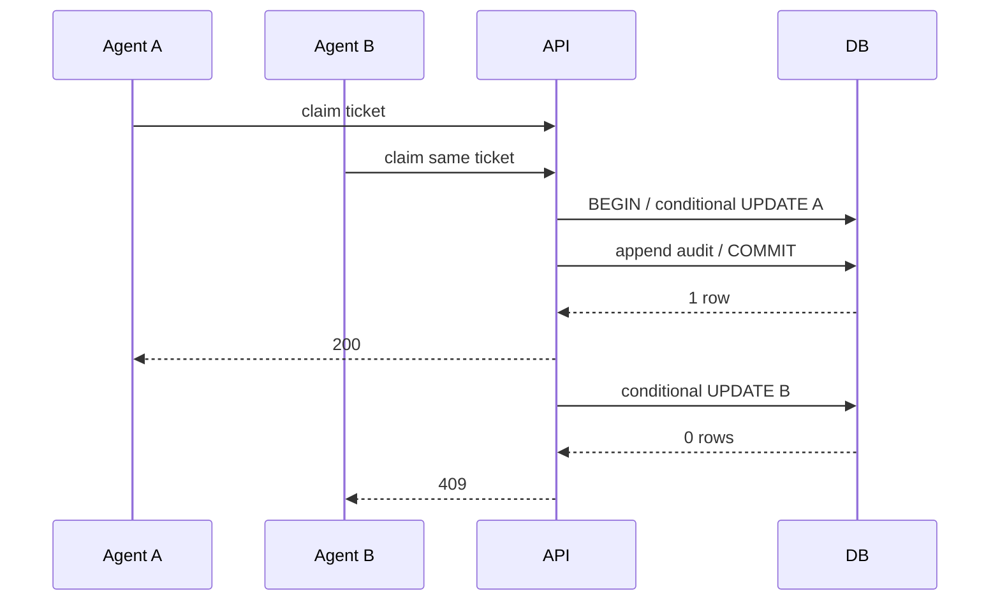
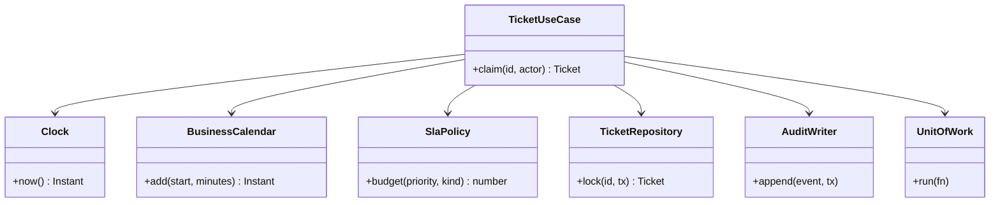

# Sequence and class views

```mermaid
sequenceDiagram
 participant J as Scheduler
 participant DB
 participant C as Customer
 J->>DB: lock due ticket / recheck
 C->>DB: reply use case waits for ticket lock
 J->>DB: close + audit / commit if overdue
 C->>DB: recheck state; new ticket if closed
```

